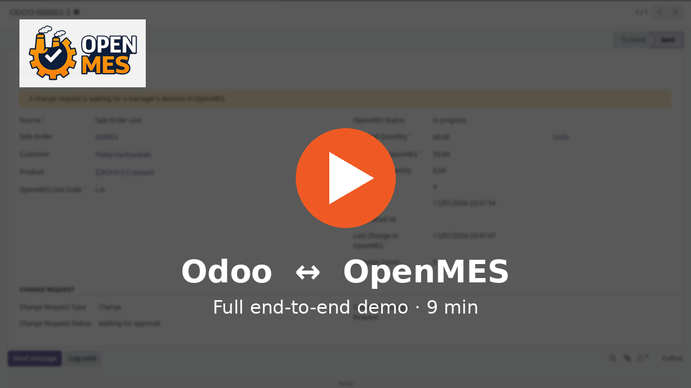

# OpenMES Odoo integration

An Odoo 20.0 module, **OpenMES Connector** (`openmes_connector/`), that connects
[Odoo](https://www.odoo.com) with [OpenMES](https://github.com/Mes-Open/OpenMes),
the open-source manufacturing execution system, through the OpenMES ERP API.

> **Part of the OpenMES ecosystem** — see the main project at
> [github.com/Mes-Open/OpenMes](https://github.com/Mes-Open/OpenMes).

## Demo

Nine minutes, one take: connecting Odoo to OpenMES, a sale order becoming a work order, a
quantity change approved on the shop floor, the settlement coming back, and manufacturing
orders closed automatically. [Download / play the MP4](https://github.com/Mes-Open/OpenMES-Odoo-integration/releases/download/18.0.1.1.14/openmes-odoo-e2e-demo.mp4).

## What it does

| Direction | What |
|---|---|
| Odoo → OpenMES | Confirmed sale order lines **or** manufacturing orders become OpenMES work orders (source, customer and currency included) |
| Odoo → OpenMES | Quantity / date changes and cancellations — applied at once before production starts, sent as change requests once it is running |
| OpenMES → Odoo | Status, produced quantity and the manager's decision on change requests; webhooks (signed, queued) with polling as a fallback |
| OpenMES → Odoo | Manufacturing orders closed automatically when the work order is done; activities for rejected requests and quantity differences |
| OpenMES → Odoo | Stock documents (material issues, product receipts) booked as stock moves; work-order settlement (scrap, cost) |
| Odoo → OpenMES | Products, BoM operations as routings, components as materials, BoMs as recipes, on-hand stock and material lots |
| Both | Production lines picked from OpenMES; settings per company |

Full configuration and usage: [`openmes_connector/README.rst`](openmes_connector/README.rst).

## Requirements

| | |
|---|---|
| Odoo | 20.0 (Community or Enterprise) — `sale_management`, `sale_stock`, `mrp` |
| OpenMES | a version with the ERP integration API (API keys with scopes, change requests, webhooks) |
| Hosting | Odoo.sh or on-premise. Custom modules cannot be installed on Odoo Online (SaaS). |

## Installation

Copy `openmes_connector/` into your Odoo addons path, update the apps list and
install **OpenMES Connector**. Then follow *Configuration* in
[`openmes_connector/README.rst`](openmes_connector/README.rst): create an API key in
OpenMES (Settings → API Keys), enter the URL and key in Odoo (Settings → OpenMES),
test the connection and register the webhook.

## Data sent to OpenMES

The module sends to **your own** OpenMES instance (the URL you configure): work
orders (product, quantity, dates, customer name, sale order reference, price),
products, bills of materials and routings, stock quantities and lots. Nothing is
sent anywhere else.

## Branches

One branch per Odoo version: `18.0`, `19.0`, `20.0`.

## License

LGPL-3 — see [LICENSE](LICENSE) and [COPYING](COPYING).

## Contact

Questions, implementation help, bug reports and feature requests:
**[contact@getopenmes.com](mailto:contact@getopenmes.com)**

---

<a href="https://getopenmes.com"><b>getopenmes.com</b></a>

